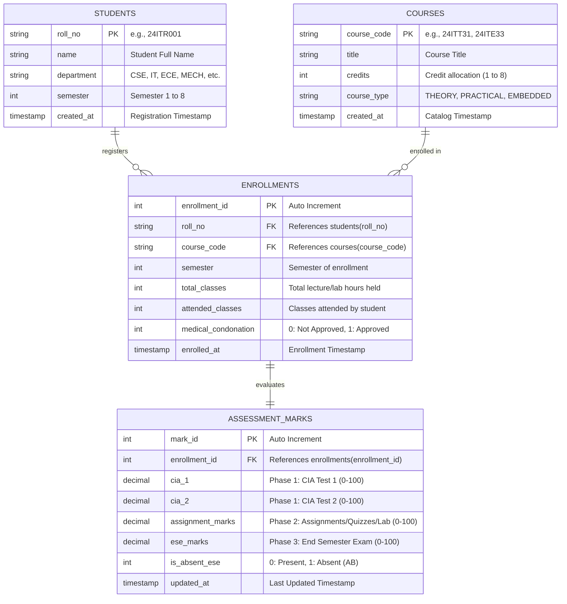

# Kongu Engineering College (Autonomous) - Regulation 2024 (R2024)
## Student Academic & Continuous Evaluation System using Java JDBC

---

## 1. System Overview & Objective
This database-driven Java application is designed and implemented according to **Kongu Engineering College (Autonomous) - Regulation 2024 (R2024)**. It manages student academic profiles, tracks attendance eligibility, supports phased/incremental Continuous Internal Assessment (CIA) and End Semester Examination (ESE) marks entry ("Then and Now"), evaluates academic performance across diverse course structures (Theory, Practical, and Embedded), and generates formal academic reports including semester mark sheets with SGPA, attendance defaulter lists, and class performance summaries.

---

## 2. System Architecture & Database Design

### 2.1 Entity Relationship Diagram (ERD)



### 2.2 Table Specifications
1. **`students`**: Stores student registration details (`roll_no`, `name`, `department`, `semester`).
2. **`courses`**: Maintains the catalog of courses (`course_code`, `title`, `credits`, `course_type`).
3. **`enrollments`**: Captures semester enrollments and continuous attendance tracking (`total_classes`, `attended_classes`, `medical_condonation`). Enforces unique constraint on `(roll_no, course_code, semester)`.
4. **`assessment_marks`**: Stores incremental marks across the semester:
   - **Phase 1 (Mid-Semester)**: CIA Test 1 (0–100) and CIA Test 2 (0–100).
   - **Phase 2 (End of Semester - CIA)**: Assignments / Quizzes / Lab Evaluations (0–100).
   - **Phase 3 (Post Semester)**: End Semester Examination (ESE) Marks (0–100) and Mark Absence (AB).

---

## 3. KEC Regulation 2024 (R2024) Evaluation Rules & Engine

### 3.1 Course Weightage & Minimum Passing Thresholds
| Course Type | CIA Weightage | ESE Weightage | ESE Passing Minimum Threshold | Overall Pass Minimum (Aggregate) |
| :--- | :---: | :---: | :---: | :---: |
| **THEORY** | **40%** | **60%** | **45%** ($27.0$ marks out of $60$) | **50 Marks** (out of 100) |
| **PRACTICAL** | **60%** | **40%** | **50%** ($20.0$ marks out of $40$) | **50 Marks** (out of 100) |
| **EMBEDDED** | **50%** | **50%** | **45%** ($22.5$ marks out of $50$) | **50 Marks** (out of 100) |

### 3.2 Continuous Internal Assessment (CIA) Component Computation
- **Theory Courses**:
  $$\text{Raw CIA}_{100} = \left(\frac{\text{CIA}_1 + \text{CIA}_2}{2}\right) \times 0.60 + \text{Assignments/Quizzes} \times 0.40$$
  $$\text{Scaled CIA}_{40} = \text{Raw CIA}_{100} \times 0.40$$
- **Practical Courses**:
  $$\text{Raw CIA}_{100} = \left(\frac{\text{CIA}_1 + \text{CIA}_2}{2}\right) \times 0.40 + \text{Lab Evaluation} \times 0.60$$
  $$\text{Scaled CIA}_{60} = \text{Raw CIA}_{100} \times 0.60$$
- **Embedded Courses**:
  $$\text{Raw CIA}_{100} = \left(\frac{\text{CIA}_1 + \text{CIA}_2}{2}\right) \times 0.50 + \text{Practical/AAT} \times 0.50$$
  $$\text{Scaled CIA}_{50} = \text{Raw CIA}_{100} \times 0.50$$

### 3.3 Attendance Rules & Grading
- **$\ge 75\%$**: Fully eligible to appear for ESE.
- **$65\% \le \text{Attendance} < 75\%$**: Conditionally eligible. Requires formal Medical Condonation approval. If approved, eligible for ESE; if unapproved, awarded **SA** grade.
- **$< 65\%$**: Barred from appearing in ESE. Awarded **SA** (Shortage of Attendance) grade ($0$ Grade Points).

### 3.4 10-Point Grading System
| Mark Range | Letter Grade | Description | Grade Point | Status |
| :---: | :---: | :--- | :---: | :---: |
| **$91 - 100$** | **O** | Outstanding | **10** | PASS |
| **$81 - 90$** | **A+** | Excellent | **9** | PASS |
| **$71 - 80$** | **A** | Very Good | **8** | PASS |
| **$61 - 70$** | **B+** | Good | **7** | PASS |
| **$50 - 60$** | **B** | Average | **6** | PASS |
| **$< 50$ or ESE Min Failed** | **RA** | Re-Appearance | **0** | FAIL |
| **Shortage of Attendance** | **SA** | Attendance $< 65\%$ | **0** | FAIL (BARRED) |
| **Absent in ESE** | **AB** | Absent in Exam | **0** | ABSENT |

### 3.5 SGPA and Percentage Formulas
$$\text{SGPA} = \frac{\sum (\text{Course Credits} \times \text{Grade Points Earned})}{\sum \text{Total Enrolled Credits}}$$
$$\text{Equivalent Percentage} = \text{SGPA} \times 10$$

---

## 4. Execution Documentation & Screenshot Proofs

### Proof 1: Student Registration, Course Catalog & Attendance Tracking
Demonstrates adding student `24ITR001` (Aravind Kumar S), adding course `24ITE33` (Object-Oriented Programming with Java, Embedded, 4 Credits), and enrolling the student with attendance tracking ($56/60 = 93.33\%$).


---

### Proof 2: Incremental Marks Entry ("Then and Now")
Demonstrates phased mark entry across the semester:
- **Phase 1 (Mid-Semester)**: CIA 1 ($90.00$) and CIA 2 ($92.00$).
- **Phase 2 (End-of-Semester)**: Continuous Practical Evaluation ($94.00$).
- **Phase 3 (Post-Semester)**: ESE Marks ($90.00$) and verifying ESE minimum pass threshold ($45.0 \ge 22.5$).


---

### Proof 3: Generated Student Semester Mark Sheet with SGPA & Percentage
Demonstrates formal KEC Controller of Examinations Grade Sheet generation for Roll Number `24ITR001`:
- Course-by-course breakdown: Theory (`24ITT31`), Practical (`24ITP32`), Embedded (`24ITE33`).
- Scaled Internal and External scores.
- 10-Point Grade assignments (`O`, `O`, `O`).
- **Total Credits Enrolled**: $9$ | **Earned**: $9$ | **Total Points**: $90$.
- **SGPA**: $10.00$ | **Equivalent Percentage**: $100.00\%$.


---

### Proof 4: Attendance Defaulter Report
Demonstrates automatic identification of students with attendance $< 65\%$, barring them from ESE and flagging them with grade **SA** (e.g., student `24ITR003`).


---

### Proof 5: Class Performance & Department-wise Result Summary
Demonstrates department-wise aggregate analytics for IT Department Semester 3:
- Total students, pass rate ($66.67\%$).
- Class Average SGPA ($5.93 / 10.00$).
- Grade distribution breakdown across $O, A+, A, B+, B, RA, SA, AB$.


---

## 5. Deliverables & Code Structure

```
project-bolt-sb1-fszx1w13/
├── kec_schema.sql             # Production MySQL 8.x schema DDL with sample records
├── kec_schema_sqlite.sql      # Standalone SQLite 3.x schema DDL
├── db.properties              # Database configuration (seamless switch: sqlite / mysql)
│
├── DBConnection.java          # JDBC connection manager with auto-init & DDL fallback
├── Student.java               # Student domain model
├── Course.java                # Course domain model (THEORY, PRACTICAL, EMBEDDED)
├── Enrollment.java            # Enrollment & continuous attendance tracking model
├── AssessmentMarks.java       # Phased marks model (Phase 1, 2, 3)
├── CourseEvaluationResult.java# Single course evaluation according to KEC R2024
├── StudentSemesterResult.java # Aggregated semester grade sheet & SGPA calculation model
├── ClassPerformanceSummary.java# Department-wise analytics model
│
├── StudentDAO.java            # SQL CRUD operations for students
├── AcademicDAO.java           # Assessment engine, courses, enrollments & marks DAO
├── MainApp.java               # Interactive menu-driven console CLI application
├── VerifyKecEngine.java       # Automated programmatic unit verification suite
├── GenerateScreenshots.java   # Graphics2D graphical terminal screenshot renderer
│
├── compile.bat                # 1-click Windows compilation script
├── run.bat                    # 1-click execution script for MainApp
├── test.bat                   # 1-click test verification script
│
├── lib/                       # Bundled JDBC & SLF4J libraries (Zero-setup)
│   ├── sqlite-jdbc-3.45.1.0.jar
│   ├── mysql-connector-j-8.3.0.jar
│   ├── slf4j-api-2.0.12.jar
│   └── slf4j-simple-2.0.12.jar
│
└── docs/screenshots/          # Generated execution proof images
    ├── screenshot_1_add_student_course.png
    ├── screenshot_2_incremental_marks.png
    ├── screenshot_3_grade_sheet_sgpa.png
    ├── screenshot_4_attendance_defaulters.png
    └── screenshot_5_class_summary.png
```

---

## 6. How to Compile and Run

### 6.1 Using Provided Batch Scripts (Windows)
Double-click or run from command prompt:
1. `compile.bat` — Compiles all `.java` files.
2. `run.bat` — Launches the menu-driven application (`MainApp`).
3. `test.bat` — Runs the verification test suite.

### 6.2 Manual CLI Commands
```powershell
# Compile
javac -encoding UTF-8 -cp ".;lib/*" *.java

# Run Main Application
java -cp ".;lib/*" MainApp

# Run Verification Tests
java -cp ".;lib/*" VerifyKecEngine
```

### 6.3 Switching between SQLite and MySQL
Edit `db.properties`:
- For zero-setup out-of-the-box local database:
  ```properties
  db.type=sqlite
  sqlite.url=jdbc:sqlite:kec_academic_r2024.db
  ```
- For local MySQL Server:
  ```properties
  db.type=mysql
  mysql.url=jdbc:mysql://localhost:3306/kec_academic_r2024?createDatabaseIfNotExist=true&useSSL=false&allowPublicKeyRetrieval=true
  mysql.user=root
  mysql.password=your_mysql_password
  ```
