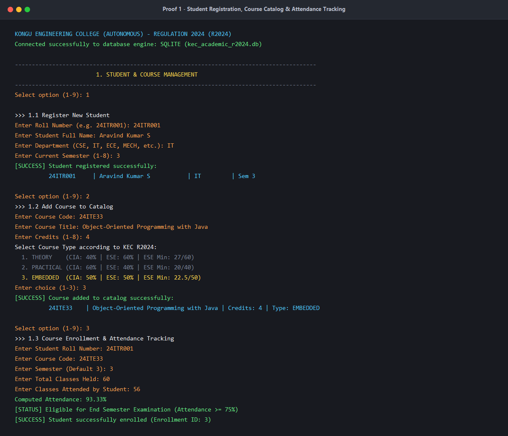
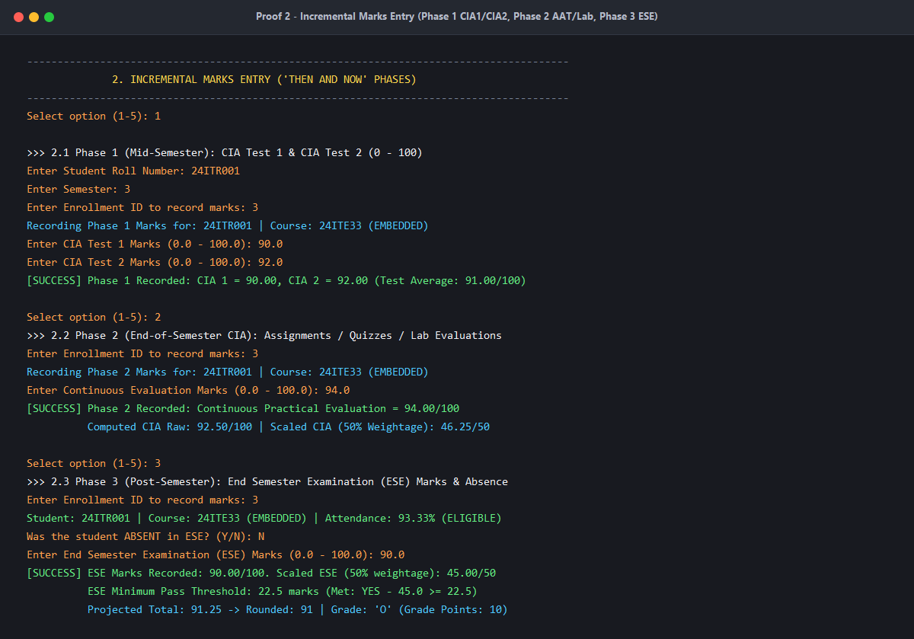
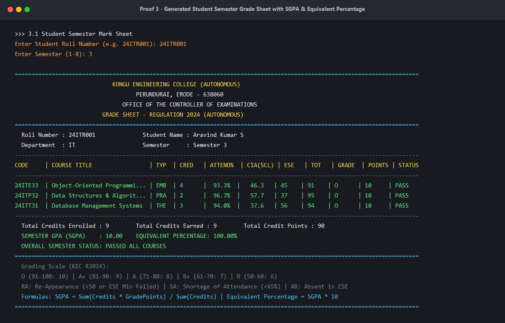
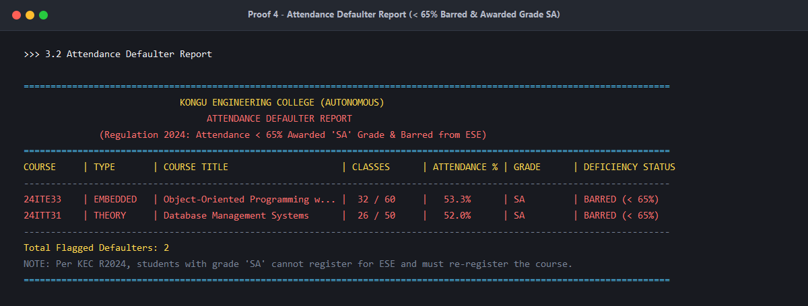
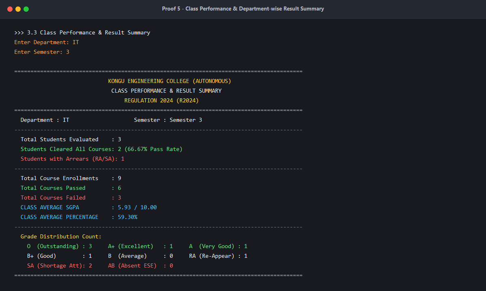

# 🎓 Kongu Engineering College (Autonomous) — Regulation 2024 (R2024)
## Student Academic & Continuous Evaluation System using Java JDBC

[](https://adoptium.net/)
[](https://docs.oracle.com/javase/8/docs/technotes/guides/jdbc/)
[](https://www.sqlite.org/)
[](https://www.mysql.com/)
[](https://kongu.ac.in/)

An autonomous, database-driven academic evaluation engine built with **Java JDBC** according to **Kongu Engineering College (Autonomous) - Regulation 2024 (R2024)**. The system manages student profiles, course catalogs across all instructional types (Theory, Practical, Embedded), tracks continuous attendance eligibility, performs phased incremental Continuous Internal Assessment (CIA) & End Semester Examination (ESE) entry, and calculates SGPA and Equivalent Percentage on a 10-point scale.

---

## 📌 Quick Resource Links

| Resource | Direct Link |
| :--- | :--- |
| 📦 **Direct ZIP Download** | [Download Source Code (ZIP)](https://github.com/sriniramesh26/Student-Academic-System-Java-JDBC/archive/refs/heads/main.zip) |
| 📖 **System Execution Manual** | [View Execution Manual Document (Markdown)](EXECUTION_DOCUMENTATION.md) |
| 🎥 **Video Demonstration** | [Watch Video Demo on YouTube](https://youtu.be/your-demo-video-link) *(Click to watch full CLI walkthrough)* |
| 🗄️ **MySQL Schema Script** | [Download `kec_schema.sql`](kec_schema.sql) |
| 🗃️ **SQLite Schema Script** | [Download `kec_schema_sqlite.sql`](kec_schema_sqlite.sql) |
| 📂 **GitHub Repository** | [sriniramesh26/Student-Academic-System-Java-JDBC](https://github.com/sriniramesh26/Student-Academic-System-Java-JDBC) |

---

## 🛠️ Technology Stack

| Layer | Technology | Details |
| :--- | :--- | :--- |
| **Language** | **Java SE 21 (LTS)** | Core Object-Oriented Programming, Java Collections, AWT for proof generation |
| **Data Access** | **Java JDBC API** | Safe `PreparedStatement` queries, transactions, dynamic schema initialization |
| **Default Embedded Database** | **SQLite 3.45.1.0** | Zero-configuration local database (`kec_academic_r2024.db`) bundled in `lib/` |
| **Production Database** | **MySQL 8.3.0** | Enterprise relational database ready via `db.properties` connection pool |
| **Logging Bridge** | **SLF4J 2.0.12** | Clean log routing and driver support |
| **Automation Scripts** | **Windows Batch (.bat)** | 1-Click build (`compile.bat`), launcher (`run.bat`), and test suite (`test.bat`) |
| **Documentation & Assets** | **Markdown / PNG** | High-resolution anti-aliased graphical screenshots & Mermaid diagrams |

---

## 🎯 System Capabilities

1. **Student & Course Management**:
   - Register students with Roll Number (e.g., `24ITR001`), Full Name, Department (CSE, IT, ECE, MECH, etc.), and Semester.
   - Maintain catalog with course types: **THEORY**, **PRACTICAL**, and **EMBEDDED**.
   - Continuous attendance tracking (total classes held vs. classes attended).

2. **Incremental Marks Entry ("Then and Now")**:
   - **Phase 1 (Mid-Semester)**: CIA Test 1 (0–100) and CIA Test 2 (0–100).
   - **Phase 2 (End of Semester - CIA)**: Assignments / Quizzes / Lab Continuous Evaluation (0–100).
   - **Phase 3 (Post Semester)**: End Semester Examination (ESE) Marks (0–100) and Absence (`AB`).

3. **Academic Evaluation & Reports**:
   - **Official Semester Mark Sheet**: Complete grade sheet showing internal scores, external scores, totals, letter grades, credit points, SGPA, and Equivalent Percentage.
   - **Attendance Defaulter Report**: Identifies students with $< 65\%$ attendance barred from ESE and awarded Grade `SA`.
   - **Class Performance Summary**: Department-wise pass/fail count, pass percentage, and Class Average SGPA.

---

## ⚖️ KEC Regulation 2024 (R2024) Weightage & Grading Engine

### 1. Course Weightage & Passing Minimums
| Course Type | CIA Weightage | ESE Weightage | ESE Passing Minimum Threshold | Overall Minimum Pass Mark |
| :--- | :---: | :---: | :---: | :---: |
| **THEORY** | **40%** | **60%** | **45%** ($27.0$ marks out of $60$) | **50 Marks** (out of 100) |
| **PRACTICAL** | **60%** | **40%** | **50%** ($20.0$ marks out of $40$) | **50 Marks** (out of 100) |
| **EMBEDDED** | **50%** | **50%** | **45%** ($22.5$ marks out of $50$) | **50 Marks** (out of 100) |

### 2. Continuous Internal Assessment (CIA) Formula
- **Theory**: $\text{CIA}_{100} = \left(\frac{\text{CIA}_1 + \text{CIA}_2}{2}\right) \times 0.60 + \text{Assignments} \times 0.40$
- **Practical**: $\text{CIA}_{100} = \left(\frac{\text{CIA}_1 + \text{CIA}_2}{2}\right) \times 0.40 + \text{Lab Evaluation} \times 0.60$
- **Embedded**: $\text{CIA}_{100} = \left(\frac{\text{CIA}_1 + \text{CIA}_2}{2}\right) \times 0.50 + \text{Practical Component} \times 0.50$

### 3. Attendance Eligibility Filter
- **$\ge 75\%$**: Fully eligible to appear for ESE.
- **$65\% \text{ to } 74.9\%$**: Conditionally eligible. Requires formal Medical Condonation approval.
- **$< 65\%$**: Barred from appearing in ESE. Awarded **`SA`** (Shortage of Attendance) grade ($0$ Grade Points).

### 4. 10-Point Letter Grading System
| Mark Bracket | Grade | Description | Grade Point | Result |
| :---: | :---: | :--- | :---: | :---: |
| **$91 - 100$** | **O** | Outstanding | **10** | PASS |
| **$81 - 90$** | **A+** | Excellent | **9** | PASS |
| **$71 - 80$** | **A** | Very Good | **8** | PASS |
| **$61 - 70$** | **B+** | Good | **7** | PASS |
| **$50 - 60$** | **B** | Average | **6** | PASS |
| **$< 50$ or Failed ESE Min** | **RA** | Re-Appearance | **0** | FAIL |
| **Attendance $< 65\%$** | **SA** | Shortage of Attendance (Barred) | **0** | FAIL (SA) |
| **Absent in ESE** | **AB** | Absent in Examination | **0** | ABSENT |

### 5. SGPA & Percentage Formulas
$$\text{SGPA} = \frac{\sum (\text{Course Credits} \times \text{Grade Points Earned})}{\sum \text{Total Enrolled Credits}}$$
$$\text{Equivalent Percentage} = \text{SGPA} \times 10$$

---

## 🚀 How to Run the Project

### Prerequisites
- **Java Development Kit (JDK) 11 or higher** (JDK 21 LTS recommended).
  - Verify your installation:
    ```bash
    java -version
    javac -version
    ```
  - [Download Java JDK 21 LTS](https://adoptium.net/)

---

### Method 1: The Fastest Way (1-Click Batch Files on Windows)
1. Download or clone this repository.
2. In the project folder:
   - Double-click **`compile.bat`** to build the application.
   - Double-click **`run.bat`** to launch the interactive menu.
   - Double-click **`test.bat`** to run the automated test suite.

---

### Method 2: Command Prompt (`cmd.exe`) / PowerShell
1. Open Command Prompt in the project folder:
   ```cmd
   cd /d "C:\path\to\Student-Academic-System-Java-JDBC"
   ```
2. **Compile** all Java files with bundled libraries:
   ```cmd
   javac -encoding UTF-8 -cp ".;lib/*" *.java
   ```
3. **Run** the main application:
   ```cmd
   java -cp ".;lib/*" MainApp
   ```
4. **Run** the automated test verification suite:
   ```cmd
   java -cp ".;lib/*" VerifyKecEngine
   ```

---

### Method 3: Linux / macOS (Terminal)
```bash
# Clone the repository
git clone https://github.com/sriniramesh26/Student-Academic-System-Java-JDBC.git
cd Student-Academic-System-Java-JDBC

# Compile (use colon : as classpath separator on Unix)
javac -encoding UTF-8 -cp ".:lib/*" *.java

# Run interactive system
java -cp ".:lib/*" MainApp

# Run verification test suite
java -cp ".:lib/*" VerifyKecEngine
```

---

## ⚙️ Database Configuration

The application includes dual database support managed via `db.properties`:

### Default: Zero-Configuration SQLite (Embedded)
No external database installation required! The SQLite engine is bundled inside `lib/` and will create `kec_academic_r2024.db` automatically:
```properties
db.type=sqlite
sqlite.url=jdbc:sqlite:kec_academic_r2024.db
```

### Optional: Production MySQL Server
1. Import `kec_schema.sql` into your MySQL server:
   ```cmd
   mysql -u root -p < kec_schema.sql
   ```
2. In `db.properties`, change:
   ```properties
   db.type=mysql
   mysql.driver=com.mysql.cj.jdbc.Driver
   mysql.url=jdbc:mysql://localhost:3306/kec_academic_r2024?createDatabaseIfNotExist=true&useSSL=false&allowPublicKeyRetrieval=true&serverTimezone=UTC
   mysql.user=root
   mysql.password=your_mysql_password
   ```

---

## 📸 Execution Proofs & Screenshots

### Proof 1: Student Registration, Course Catalog & Attendance Tracking
Adding student `24ITR001`, catalog course `24ITE33` (Embedded, 4 Credits), and recording attendance ($56/60 = 93.33\%$).



---

### Proof 2: Incremental Marks Entry ("Then and Now")
Phased entry: Phase 1 (CIA 1 & CIA 2), Phase 2 (Assignments/Quizzes), Phase 3 (ESE Marks & Threshold Validation).



---

### Proof 3: Generated Student Semester Mark Sheet with SGPA
Formal KEC Grade Sheet displaying individual course scores, 10-point grades, calculated SGPA (`10.00`), and percentage (`100.00%`).



---

### Proof 4: Attendance Defaulter Report
Automatic flagging of attendance shortage ($< 65\%$) with grade `SA` and examination barring.



---

### Proof 5: Class Performance & Department-wise Result Summary
Aggregate analytics for the IT department showing pass rates, class average SGPA, and complete grade distribution.



---

## 🗂️ Project Directory Structure

```
Student-Academic-System-Java-JDBC/
├── kec_schema.sql             # Production MySQL 8.x DDL with sample records
├── kec_schema_sqlite.sql      # Standalone SQLite 3.x schema DDL
├── db.properties              # Database configuration (sqlite / mysql)
│
├── DBConnection.java          # JDBC connection manager with dynamic schema fallback
├── Student.java               # Student domain model
├── Course.java                # Course domain model (THEORY, PRACTICAL, EMBEDDED)
├── Enrollment.java            # Enrollment and continuous attendance tracking model
├── AssessmentMarks.java       # Phased marks model (Phase 1, 2, 3)
├── CourseEvaluationResult.java# Single course evaluation model (KEC R2024)
├── StudentSemesterResult.java # Semester mark sheet & SGPA aggregator
├── ClassPerformanceSummary.java# Department-wise academic analytics
│
├── StudentDAO.java            # Student CRUD operations
├── AcademicDAO.java           # Courses, enrollments, marks, and evaluation engine
├── MainApp.java               # Interactive menu-driven console CLI application
├── VerifyKecEngine.java       # Programmatic verification test suite
├── GenerateScreenshots.java   # Graphical terminal proof renderer
│
├── compile.bat                # 1-Click Windows compiler
├── run.bat                    # 1-Click Windows launcher
├── test.bat                   # 1-Click Windows test runner
│
├── lib/                       # Bundled JDBC & SLF4J libraries (Zero-setup)
│   ├── sqlite-jdbc-3.45.1.0.jar
│   ├── mysql-connector-j-8.3.0.jar
│   ├── slf4j-api-2.0.12.jar
│   └── slf4j-simple-2.0.12.jar
│
├── docs/                      # Proof screenshots
│   └── screenshots/
│       ├── screenshot_1_add_student_course.png
│       ├── screenshot_2_incremental_marks.png
│       ├── screenshot_3_grade_sheet_sgpa.png
│       ├── screenshot_4_attendance_defaulters.png
│       └── screenshot_5_class_summary.png
│
├── README.md                  # Comprehensive project documentation
└── EXECUTION_DOCUMENTATION.md # Detailed execution manual & academic specification
```

---

## 📄 License & Academic Attribution
Developed for **Kongu Engineering College (Autonomous), Perundurai, Erode - 638060**, under **Regulation 2024 (R2024)** Academic System.

- **Author**: SRINIVASAN R ([@sriniramesh26](https://github.com/sriniramesh26))
- **Repository**: [Student-Academic-System-Java-JDBC](https://github.com/sriniramesh26/Student-Academic-System-Java-JDBC)
